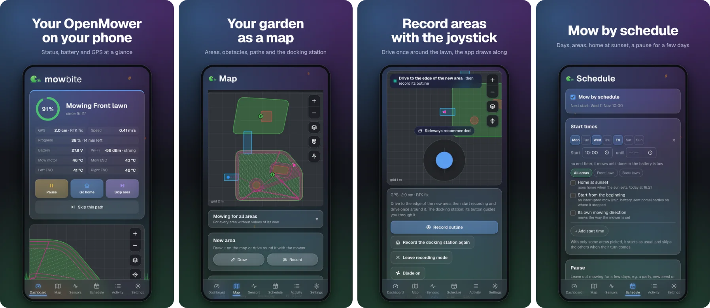
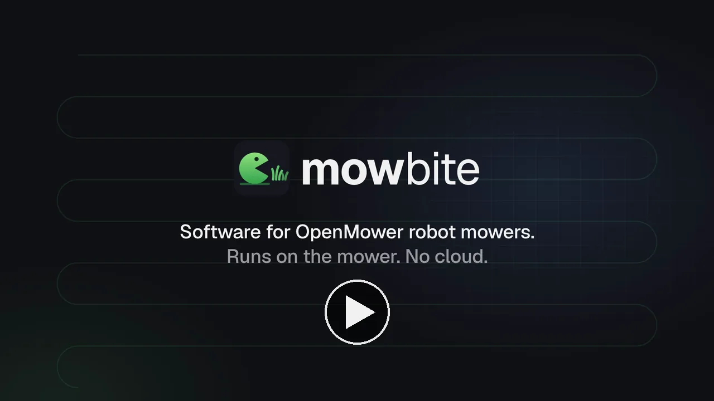
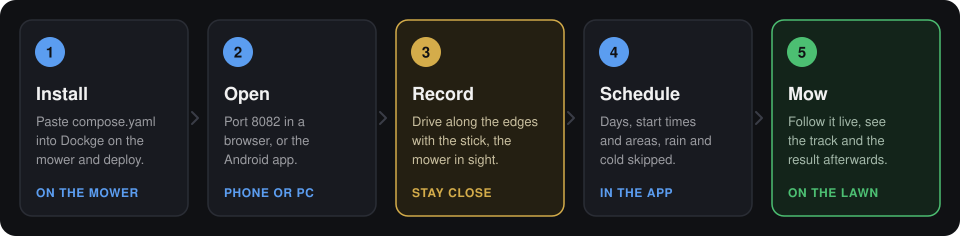
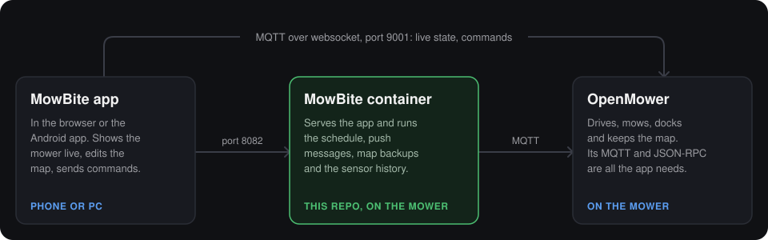

<p align="center">
  
</p>

<h1 align="center">MowBite</h1>

<p align="center">
  The app for your robot mower: live dashboard, map editor, recording by driving, schedule and history.<br>
  It runs on the mower itself. No cloud and no account.
</p>

<p align="center">
  <a href="https://github.com/mkaaaaaay/mowbite/releases"></a>
  
  <a href="LICENSE"></a>
  <a href="https://discord.gg/VpPFRx9Ce4"></a>
</p>

<p align="center">
  <a href="#get-started"><b>Get started</b></a> ·
  <a href="#android-app"><b>Android app</b></a> ·
  <a href="#configuration"><b>Configuration</b></a> ·
  <a href="https://discord.gg/VpPFRx9Ce4"><b>Discord</b></a>
</p>



<p align="center">
  <a href="https://youtu.be/nUGaw1tlYOk"></a><br>
  <sub>MowBite in 83 seconds, on YouTube</sub>
</p>

MowBite is a web app for [OpenMower](https://github.com/ClemensElflein/OpenMower) robot mowers. It runs on the mower
as a small container and talks to OpenMower over MQTT. Everything stays in your home network.

Open it in the browser on a phone or computer, or use the Android app. MowBite asks the mower what it can do and
leaves out what yours doesn't have. It works with the [MowBite Planner](https://github.com/mkaaaaaay/mowbite-planner) and
[Home Assistant](https://github.com/mkaaaaaay/mowbite-ha), and it is the app of
[MowBite OS](https://github.com/mkaaaaaay/mowbite-os) too.

> [!NOTE]
> MowBite is at an early stage and things still change. `latest` brings betas too, see [Install](#install) to stay on
> one version.

MowBite is a community project and not affiliated with the OpenMower project, Airseekers or YardForce. Questions, test
reports and news: the [MowBite Discord](https://discord.gg/VpPFRx9Ce4).

## Contents

- [What it does](#what-it-does)
- [Get started](#get-started)
- [Install](#install)
- [Android app](#android-app)
- [MowBite OS](#mowbite-os)
- [How it works](#how-it-works)
- [Configuration](#configuration)
- [Troubleshooting](#troubleshooting)
- [Development](#development)
- [The MowBite project](#the-mowbite-project)
- [License](#license)

## What it does

| | |
| --- | --- |
| **Dashboard** | What the mower is doing in plain words, battery, weather, progress and time left. Start, pause and send it home. |
| **Map** | Record areas, obstacles and the docking station with a thumb stick, then edit them by hand: points, split, merge, mow angle, mowing order. Aerial imagery or a garden style under it, a backup with every save, GeoJSON in and out. |
| **Schedule** | Days, start times and areas. It can skip rain and cold, waits for the battery and doesn't start in the dark unless you confirm it. |
| **Activity** | Every run with its result and track, problems explained in plain words, mowing hours, reminders for new blades and cleaning, a diagnosis file per run. |
| **Sensors** | The last 24 hours of every sensor, the battery over the weeks, GPS and Wi-Fi coverage on the map. |
| **Push messages** | Through [ntfy](https://ntfy.sh) when the mower needs you. The container sends them, no app has to be open. |
| **Settings and updates** | OpenMower's settings in the app. Updates for MowBite, OpenMower and the planner with the [MowBite Updater](https://github.com/mkaaaaaay/mowbite-updater). |
| **More** | Several mowers, a demo mower to look around, guides, several designs, English and German. |

Ideas, wishes and translations are welcome as [issues](https://github.com/mkaaaaaay/mowbite/issues).

## Get started



1. **Install.** You need OpenMower v1 or v2 with its MQTT websocket on port 9001, the default. In Dockge on the mower
   (OpenMowerOS has it on port 5001): "+ Compose", name it `mowbite`, paste [compose.yaml](compose.yaml), "Deploy".
   The terminal way is under [Install](#install).
2. **Open.** Go to `http://<your-mower>:8082` in a browser, or install the [Android app](#android-app).
3. **Record.** Drive the mower along the edges of an area with the stick on the record page, then record the docking
   station. Keep the mower in sight: it stops as soon as you let go of the stick.
4. **Schedule.** Pick days, start times and areas, or start a run by hand from the dashboard.
5. **Mow.** Follow the run live. Afterwards the activity shows its track and result.

## Install

In a terminal on the mower, as an alternative to Dockge:

```bash
mkdir -p /opt/stacks/mowbite && cd /opt/stacks/mowbite
curl -O https://raw.githubusercontent.com/mkaaaaaay/mowbite/main/compose.yaml
docker compose pull && docker compose up -d
```

The MowBite Updater comes with it, its page is on port 8083.

- **Update**: in the app under Settings, Updates, or "Update" in Dockge (in a terminal the last line above). Your
  settings stay. Reload the page afterwards, phones like to keep the old version for a while.
- **Versions**: `latest` is the newest, betas included. To stay on one, put its tag (e.g. `1.4.1`) in the image line
  of `compose.yaml`. The images are for arm64 (the mower) and amd64.
- **Build it yourself**: clone this repo and `docker compose up -d --build`. On the mower that needs about 1 GB of
  free space for a while.
- **Remove**: `docker compose down` in `/opt/stacks/mowbite`, with `-v` the saved settings and map backups go too.
  MowBite doesn't change OpenMower's files, the updater only writes the version you pick.

<details><summary><b>Older installs</b></summary>

- **In a folder of its own** (`~/mowbite`): `docker compose down` there, then set it up in Dockge as above with the
  same name. Your settings stay.
- **Installed before 1.4.0-beta.12**: tap "Update" in Dockge once, then the app shows the lines for the updater under
  Settings, Updates.

</details>

## Android app

On [Google Play](https://play.google.com/store/apps/details?id=io.github.mkaaaaaay.mowbite), or `MowBite.apk` from the
[releases](https://github.com/mkaaaaaay/mowbite/releases). On the first start it asks for your mower's address.
MowBite has to run on the mower too, the app talks to it over your home network.

## MowBite OS

On an Airseekers Tron, MowBite runs on [MowBite OS](https://github.com/mkaaaaaay/mowbite-os), a system of its own in
place of the mower's software, put on with the [MowBite OS installer](https://github.com/mkaaaaaay/mowbite-installer).
There MowBite comes with the system and needs no container. The app then also shows the setup with its safety steps,
the updates of MowBite OS and the mower's cameras. MowBite OS is at an early stage and not ready for everyday use yet.

## How it works



- The **app** connects straight to OpenMower's MQTT websocket. It reads the state, the map and the sensors there and
  sends commands and JSON-RPC calls the same way.
- The **container** serves the app on port 8082 and keeps running when no app is open: it starts the schedule, sends
  push messages, keeps map backups and records the sensor history. It holds its settings in the `settings` volume.
- The **MowBite Updater** in the same `compose.yaml` updates MowBite, OpenMower and the planner from the app, with the
  mower idle in the dock.

## Configuration

The port you open is the first number under `ports` in `compose.yaml` (`8082`). Change `openmower.ui.port` with it,
then MowBite shows up on the [OpenMower start page](https://github.com/xtech/web-openmower-entrypoint) by itself.

<details><summary><b>Settings under <code>environment</code> in <code>compose.yaml</code>, all optional</b></summary>

| Variable | What it's for |
| --- | --- |
| `MOWER_MQTT_WS_URL` | OpenMower's MQTT websocket for the browser. Default `ws://<host it's opened from>:9001`, right on the mower. |
| `MOWER_MQTT_PREFIX` | Topic prefix, only if your OpenMower uses one. |
| `MOWER_MQTT_HOST`, `_PORT` (1883), `_USER`, `_PASSWORD` | The broker the container listens to, only for one somewhere else or with a login. |
| `MOWBITE_SCHEDULER` | `off` on a second copy (e.g. on a PC), so only the one on the mower mows by schedule. |
| `UPDATER_URL` | Where the updater runs, e.g. `http://openmower:8083`, when MowBite doesn't run on the mower. |
| `MOWBITE_ORIGINS` | Other addresses MowBite is opened from, comma separated: its files on a web server of your own (`MowBite-web.zip` in the releases) or a proxy with another name. Addresses in your home network work without it. |

</details>

Settings, map backups and recorded sensor values live in the `settings` volume. Other apps can use the updates through
MowBite (`/cgi-bin/update` on port 8082) or the updater directly (port 8083).

## Troubleshooting

- **"waiting for map..." forever**: the browser can't reach MQTT. Check that `ws://<your-mower>:9001` is reachable from
  your device, and set `MOWER_MQTT_WS_URL` if MowBite doesn't run on the mower.
- **No data but the connection works**: your OpenMower may use a topic prefix, set `MOWER_MQTT_PREFIX`.
- **Saving the map fails**: OpenMower has to be running, the map is saved through it.
- **The updater doesn't list an app**: its stack has to be in `/opt/stacks`, Dockge's folder. The updater says which
  ones it can't reach, with the line that gives it their folder.

## Development

```bash
npm install
echo "NEXT_PUBLIC_MOWER_MQTT_WS_URL=ws://<your-mower>:9001" > .env.local
npm run dev    # from a phone: DEV_ORIGINS=<pc-name>,<pc-ip> npm run dev -- -H 0.0.0.0
```

The Android app is the same build packed with [Capacitor](https://capacitorjs.com) (Android SDK, JDK 21):
`npm run build && npx cap sync android && cd android && ./gradlew assembleDebug`.

## The MowBite project

- [MowBite OS](https://github.com/mkaaaaaay/mowbite-os): the software that runs the mower: positioning, mowing,
  docking and updates.
- [MowBite OS installer](https://github.com/mkaaaaaay/mowbite-installer): puts MowBite OS on an Airseekers Tron over
  USB and takes it back to the vendor system.
- [MowBite Planner](https://github.com/mkaaaaaay/mowbite-planner): the mowing planner, it keeps the whole mower away
  from edges and obstacles, not just its middle.
- [mowbite-releases](https://github.com/mkaaaaaay/mowbite-releases): the signed release files of MowBite OS.
- [MowBite for Home Assistant](https://github.com/mkaaaaaay/mowbite-ha): Home Assistant integration for OpenMower
  mowers, with the MowBite card and map.
- [MowBite Updater](https://github.com/mkaaaaaay/mowbite-updater): keeps OpenMower, MowBite and the planner up to
  date on OpenMower mowers.
- [MowBite Discord](https://discord.gg/VpPFRx9Ce4): questions, test reports and news.

## License

Copyright (C) 2026 mkay

[PolyForm Noncommercial 1.0.0](https://polyformproject.org/licenses/noncommercial/1.0.0), see [LICENSE](LICENSE).
You may use, change and pass on MowBite for any noncommercial purpose. Commercial use needs a separate license from
the licensor. MowBite comes without any warranty.

- The license doesn't cover the name MowBite or its logo. A changed version needs a name and logo of its own and
  mustn't pass itself off as MowBite or as made by its author.
- Versions up to 1.5.0-preview.5 were released under GPL-3.0 and stay under it.
- The container image also holds BusyBox and the Mosquitto clients as separate programs under their own licenses
  (GPL-2.0, EPL-2.0/EDL-1.0).

<details><summary><b>Aerial imagery</b></summary>

Built-in aerial imagery comes from the official surveying and mapping agencies under their open data licenses (CC BY
4.0, CC0, dl-de/by-2-0, dl-de/zero-2-0, Etalab 2.0, the Flemish free reuse license, swisstopo's free use terms, US
public domain). Finland's comes from the National Land Survey through the servers of Kapsi, a Finnish non-profit (CC
BY 4.0). The app shows the required attribution while imagery is on. Esri World Imagery only comes with an ArcGIS key
of your own, under Esri's terms. For a tile source you add yourself, you're responsible for its terms.

</details>
