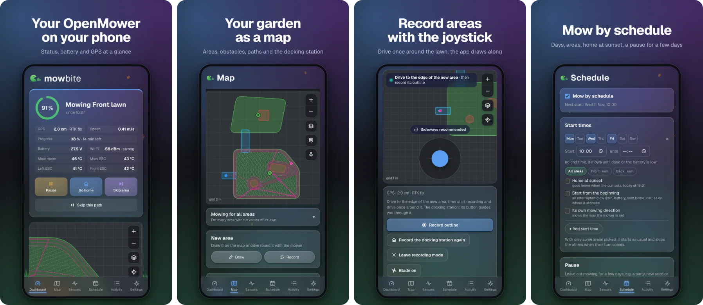

# MowBite

A web app for [OpenMower](https://github.com/ClemensElflein/OpenMower) robot mowers. It runs on the mower as a small
container and talks to OpenMower over MQTT, no cloud involved. Open it in the browser on a phone or computer, or use the
Android app.

MowBite is a community project and not affiliated with the OpenMower project.



## What it does

- **Dashboard**: what the mower is doing in plain words, battery, weather, progress and time left, start, pause, home.
- **Map**: record areas, obstacles and the docking station with a thumb stick, then edit them by hand: points, split,
  merge, mow angle, mowing order. Aerial imagery or a garden style under it, a backup with every save, GeoJSON in and out.
- **Schedule**: days, start times and areas. Skips rain and cold if you like, waits for the battery, doesn't start in
  the dark unless you confirm it.
- **Activity**: every run with its result and track, problems explained in plain words, mowing hours, reminders for new
  blades and cleaning, a diagnosis file per run.
- **Sensors** over the last 24 hours, the battery over the weeks, GPS and Wi-Fi coverage on the map.
- **Push messages** through [ntfy](https://ntfy.sh) when the mower needs you. The container sends them, no app has to
  be open.
- **Settings and updates**: OpenMower's settings in the app, updates for MowBite, OpenMower and your other stacks with
  the [MowBite Updater](https://github.com/mkaaaaaay/mowbite-updater).
- Works with the [MowBite Planner](https://github.com/mkaaaaaay/mowbite-planner) and
  [Home Assistant](https://github.com/mkaaaaaay/mowbite-ha). More than one mower, a demo mower to look around, guides,
  several designs, English and German.

For OpenMower v1 and v2. MowBite asks the mower what it can do and leaves out what yours doesn't have yet. Ideas, wishes
and translations are welcome as [issues](https://github.com/mkaaaaaay/mowbite/issues).

## Install

You need OpenMower with its MQTT websocket on port 9001 (the default). In Dockge on the mower (OpenMowerOS has it on
port 5001): "+ Compose", name it `mowbite`, paste [compose.yaml](compose.yaml), "Deploy". Or in a terminal:

```bash
mkdir -p /opt/stacks/mowbite && cd /opt/stacks/mowbite
curl -O https://raw.githubusercontent.com/mkaaaaaay/mowbite/main/compose.yaml
docker compose pull && docker compose up -d
```

Then open `http://<your-mower>:8082`. The MowBite Updater comes with it, its page is on port 8083.

- **Update**: in the app under Settings, Updates, or "Update" in Dockge (in a terminal the last line above). Your
  settings stay. Reload the page afterwards, phones like to keep the old version for a while.
- **Versions**: `latest` is the newest, betas included. To stay on one, put its tag (e.g. `1.3.0`) in the image line
  of `compose.yaml`. The images are for arm64 (the mower) and amd64.
- **Build it yourself**: clone this repo and `docker compose up -d --build`, on the mower that needs about 1 GB of
  free space for a while.
- **Remove**: `docker compose down` in `/opt/stacks/mowbite`, with `-v` the saved settings and map backups go too.
  MowBite doesn't change OpenMower's files, the updater only writes the version you pick.
- **Old install in a folder of its own** (`~/mowbite`): `docker compose down` there, then set it up in Dockge as above
  with the same name. Your settings stay.
- **Installed before 1.4.0-beta.12**: tap "Update" in Dockge once, then the app shows the lines for the updater under
  Settings, Updates.

## Android app

On [Google Play](https://play.google.com/store/apps/details?id=io.github.mkaaaaaay.mowbite), or `MowBite.apk` from the
[releases](https://github.com/mkaaaaaay/mowbite/releases). On the first start it asks for your mower's address.
MowBite has to run on the mower too, the app talks to it over your home network.

## Troubleshooting

- **"waiting for map..." forever**: the browser can't reach MQTT. Check that `ws://<your-mower>:9001` is reachable from
  your device, and set `MOWER_MQTT_WS_URL` if MowBite doesn't run on the mower.
- **No data but the connection works**: your OpenMower may use a topic prefix, set `MOWER_MQTT_PREFIX`.
- **Saving the map fails**: OpenMower has to be running, the map is saved through it.
- **The updater doesn't list an app**: its stack has to be in `/opt/stacks`, Dockge's folder. The updater says which
  ones it can't reach, with the line that gives it their folder.

## Configuration

The port you open is the first number under `ports` in `compose.yaml` (`8082`). Change `openmower.ui.port` with it, then
MowBite shows up on the [OpenMower start page](https://github.com/xtech/web-openmower-entrypoint) by itself.

Optional, under `environment` in `compose.yaml`:

| Variable | What it's for |
| --- | --- |
| `MOWER_MQTT_WS_URL` | OpenMower's MQTT websocket for the browser. Default `ws://<host it's opened from>:9001`, right on the mower. |
| `MOWER_MQTT_PREFIX` | Topic prefix, only if your OpenMower uses one. |
| `MOWER_MQTT_HOST`, `_PORT` (1883), `_USER`, `_PASSWORD` | The broker the container listens to, only for one somewhere else or with a login. |
| `MOWBITE_SCHEDULER` | `off` on a second copy (e.g. on a PC), so only the one on the mower mows by schedule. |
| `UPDATER_URL` | Where the updater runs, e.g. `http://openmower:8083`, when MowBite doesn't run on the mower. |
| `MOWBITE_ORIGINS` | Other addresses MowBite is opened from, comma separated: its files on a web server of your own (`MowBite-web.zip` in the releases) or a proxy with another name. Addresses in your home network work without it. |

Settings, map backups and recorded sensor values live in the `settings` volume. Other apps can use the updates through
MowBite (`/cgi-bin/update` on port 8082) or the updater directly (port 8083).

## Development

```bash
npm install
echo "NEXT_PUBLIC_MOWER_MQTT_WS_URL=ws://<your-mower>:9001" > .env.local
npm run dev    # from a phone: DEV_ORIGINS=<pc-name>,<pc-ip> npm run dev -- -H 0.0.0.0
```

The Android app is the same build packed with [Capacitor](https://capacitorjs.com) (Android SDK, JDK 21):
`npm run build && npx cap sync android && cd android && ./gradlew assembleDebug`.

## License

Copyright (C) 2026 mkay

GPL-3.0, see [LICENSE](LICENSE). MowBite comes without any warranty. On top of the GPL, these terms
under its section 7 apply to versions that are passed on with changes:

- The license doesn't cover the name MowBite or its logo (7e). A changed version needs a name and
  logo of its own and mustn't pass itself off as MowBite or as made by its author (7c).
- "© 2026 mkay" stays in the legal notices the app shows, next to the changed version's own (7b).

Built-in aerial imagery comes from the official surveying and mapping agencies under their open
data licenses (CC BY 4.0, CC0, dl-de/by-2-0, dl-de/zero-2-0, Etalab 2.0, the Flemish free reuse
license, swisstopo's free use terms, US public domain). Finland's comes from the National Land Survey
through the servers of Kapsi, a Finnish non-profit (CC BY 4.0). The app shows the required attribution
while imagery is on. Esri World Imagery only comes with an ArcGIS key of your own, under Esri's terms.
For a tile source you add yourself, you're responsible for its terms.
